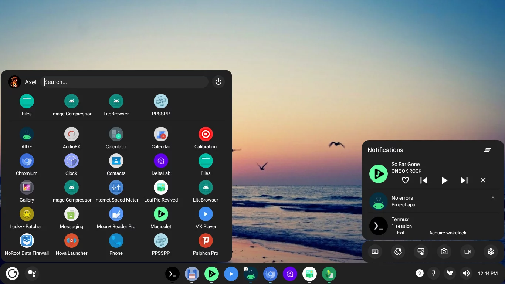

> **Fork notice.** This is **kayb28/smartdock**, a fork of
> [axel358/smartdock](https://github.com/axel358/smartdock) (GPL-3.0). It tracks
> upstream closely (same package `cu.axel.smartdock`, no rename) so upstream
> changes can still be merged, but ships extra fixes and features that are not
> yet upstream:
>
> - **Every user-reported bug closed**: AltGr firing shortcuts (#167), a
>   running-apps limit of 0 not meaning unlimited (#250), quick-settings
>   screenshots capturing the panel itself (#266), Meta+X opening the app menu
>   on Meta release (#267), the swipe activation method on touch (#264), docks
>   dying on early configuration changes (#270), dead docks after a
>   crash-reboot (#268), blank boot windows (#259) and stale adapter binds
>   (#253). See [`CHANGELOG-FORK.md`](CHANGELOG-FORK.md) for the full list.
> - **Real secondary-display support (#263)**: the dock targets the actual
>   external display (presentation category, not the raw list), window
>   tiling/resize is computed for the display the window lives on, and a failed
>   external launch falls back to the primary instead of killing the service.
> - **External-display desktop mode**: a toggle applies
>   `force_desktop_mode_on_external_displays` + `enable_freeform_support`
>   through the app's own permission, then Shizuku, then root, and
>   **"Send to screen"** moves running tasks between displays.
> - **Releases as GitHub Releases** with CI (compile + lint) green on every
>   tag; the operational diary is in [`docs/REGISTRO.md`](docs/REGISTRO.md).
>
> **Installing a fork build.** Fork APKs are debug builds signed with the
> fork's own keystore (cert SHA-256
> `4680C23198D542A0423DFD95F1A0D66A80100FA30CB72CAEDF107E41B54B41DB`). They
> **update over each other** without uninstalling and without losing settings.
> They are **not** installable over the official F-Droid build (different
> certificate) — uninstall that first. Grant `WRITE_SECURE_SETTINGS` via adb,
> Shizuku, or install as a system app, exactly as for upstream.

<div align="center">
  <h1>Smart Dock</h1>
  A user-friendly desktop mode launcher that offers a modern and customizable user interface
</div>



## Main features
- Very customizable, icons, colors, shapes, sounds
- Multi window support
- Keyboard shortcuts
- Support for both desktop and tablet layouts
- Compatible with Android 10 and above, no root required

## Install

[](https://f-droid.org/packages/cu.axel.smartdock)

You can grab the latest release from F-Droid

Note: The application should be installed as a system app in order to obtain the right permissions.
Alternatively you can use [Shizuku](https://shizuku.rikka.app).

## Usage

### Grant restricted permissions: 
On some devices Accessibility and Notification permissions might not be available. To solve this go to:  System Settings > Apps > Smartdock > 3 Dot menu (Top right corner) > Allow restricted permissions

### Secure settings
To grant secure settings permissions run the following command on an adb or root shell:
```
pm grant cu.axel.smartdock android.permission.WRITE_SECURE_SETTINGS
```

### Hide navigation bar
You might also want to hide the Android navigation bar.
[See hiding navigation bar](HideNav.md)

## Get help and ask questions 

Telegram support group: https://t.me/smartdock358

## Support the project

If you find this project useful or it has helped you in any way, consider showing your appreciation and supporting its ongoing development. 

Bitcoin Address:
```
bc1qzc0jnpzk4g838t56jshvt4j5a2a5dgfx5w9k5a
```

Thank you for your support!

## Contributors

[See contributors](Contributors.md)
